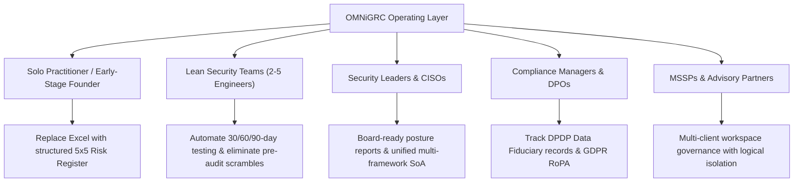
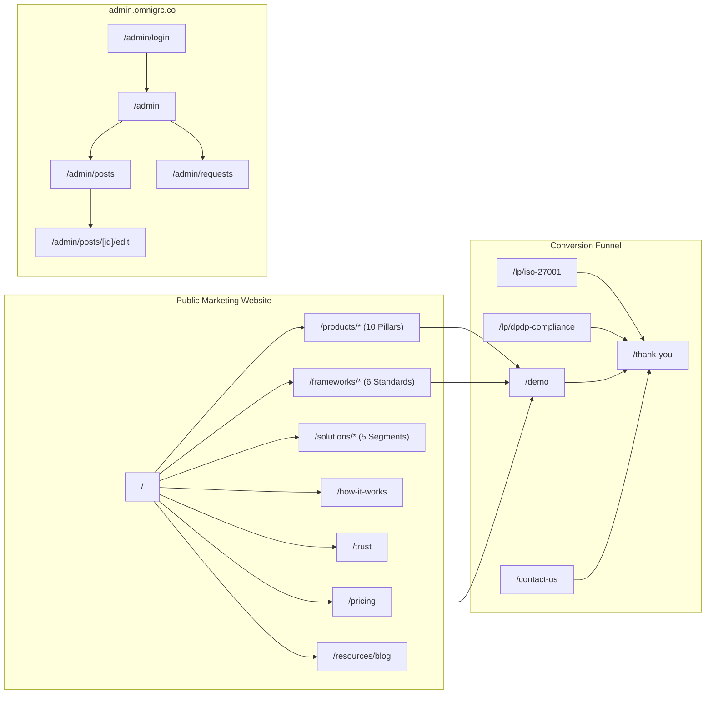
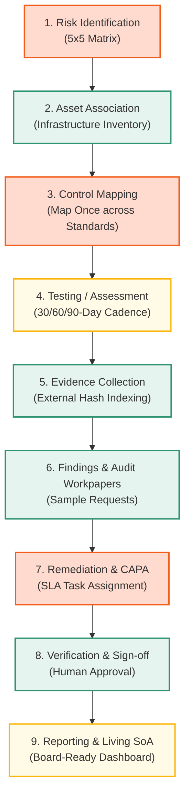
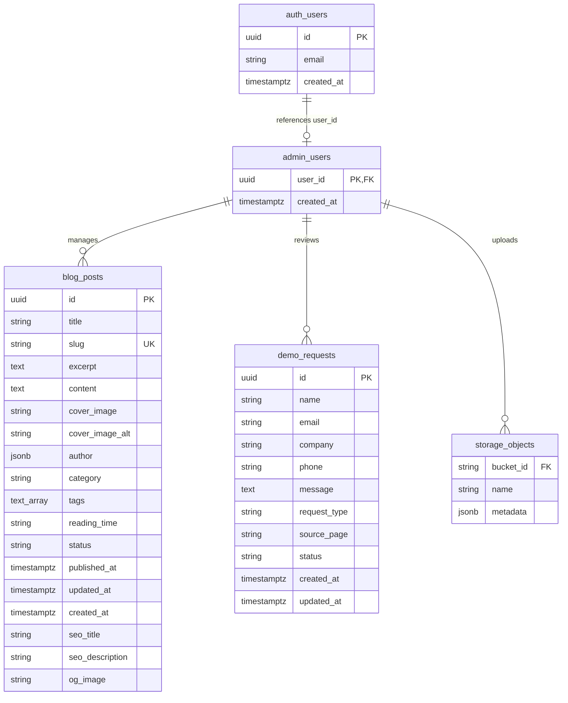
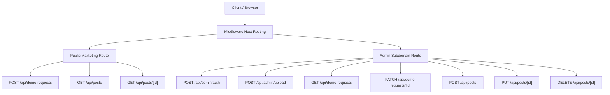
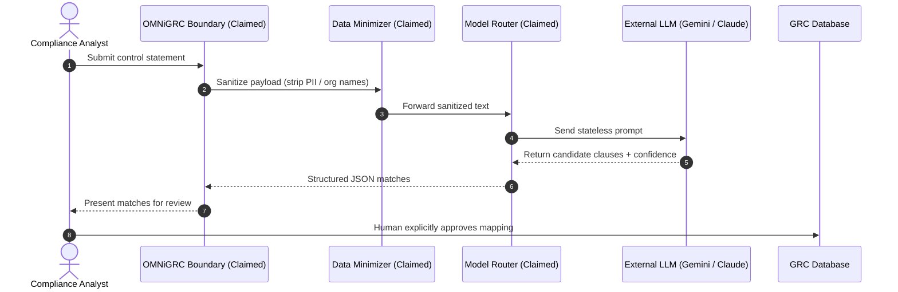
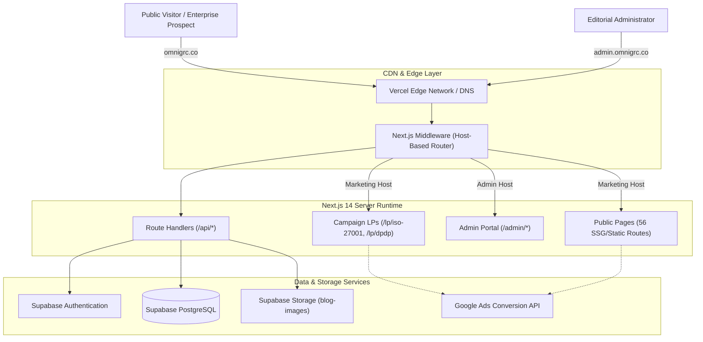
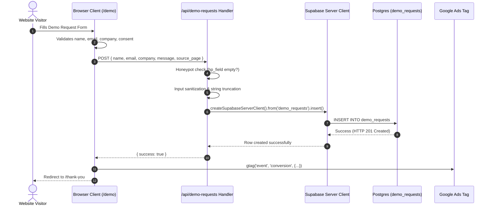

# OMNiGRC — Complete Product, Website, UI/UX & Technical Architecture Audit

**Target Audience:** Chief Executive Officer (CEO), Board of Directors, Product Leadership, and External Stakeholders  
**Audit Scope:** Public Website ([https://omnigrc.co/](https://omnigrc.co/)), Local Codebase (`OMNiGRC_UI`), Architecture, Data Models, Security, and Workflows  
**Repository Branch / Commit:** `origin/main` (latest commit `c4ed02a`)  
**Audit Execution Date:** October 26, 2026  
**Auditor Classification Standard:**
- `[Verified from Source Code]`: Supported by explicit implementation in local source files.
- `[Verified through Runtime Testing]`: Validated via compiler execution (`tsc`), production build (`npm run build`), or API invocation.
- `[Observed on Public Website]`: Confirmed live on [https://omnigrc.co/](https://omnigrc.co/).
- `[Specified in Project Documentation]`: Documented in repository configuration, schemas, or comments.
- `[Inference]`: Derived logically from engineering patterns present in the code.
- `[Not Verified / Unverified]`: Claimed in marketing copy or UI labels, but missing implementation evidence.

---

## 1. Executive Summary

### 1.1 Platform Identity & Core Value Proposition
OMNiGRC positions itself as an enterprise-grade, unified Governance, Risk, and Compliance (GRC) operating layer engineered specifically for lean security teams, CISOs, compliance managers, and Managed Security Service Providers (MSSPs). Its primary thesis is **"Compliance Doesn't Fail on Frameworks, It Fails on Fragmentation"** — aiming to replace disconnected spreadsheets, ad-hoc Jira tickets, and screenshot-chasing emails with a unified "Map Once, Satisfy Many" operating model across six core compliance frameworks (ISO 27001:2022, ISO 42001:2023, SOC 2 Type II, GDPR, India DPDP Act 2023, and HIPAA Security Rule).

### 1.2 Actual Repository Reality vs. Marketing Claims
A comprehensive, line-by-line inspection of the repository reveals a fundamental architectural dichotomy:

| Dimension | Public Marketing / UI Claim | Actual Codebase Reality | Status |
| :--- | :--- | :--- | :--- |
| **Primary System Type** | Fully automated cloud GRC SaaS platform with continuous telemetry and AI parsing | High-performance public marketing website and CMS with interactive demonstration widgets | `UI/Demo Only` |
| **Product Modules (10 Pillars)** | 10 live operational modules (Risk Register, Asset Inventory, Control Mapping, Compliance Board, etc.) | Static showcase pages (`/products/*`) featuring interactive client-side React mockups with in-memory state | `UI/Demo Only` |
| **GRC Database Schema** | Multi-tenant relational schema for assets, risks, controls, evidence, and audits | Supabase database contains only 3 tables: `demo_requests`, `blog_posts`, and `admin_users` | `Partially Implemented` (Lead/CMS only) |
| **AI Integration** | Tiered Model Router routing sanitized payloads to Gemini 2.5 and Claude Haiku | Zero AI SDKs, API keys, prompt templates, or model endpoints exist in code | `Planned / Referenced Only` |
| **Tenant Isolation** | Enterprise multi-tenant isolation with dedicated database schemas or application boundaries | No tenant ID or organization column exists; single administrative user list | `Unverified / Not Implemented` |
| **Lead & Content Management** | Live demo booking, lead capture, and blog publishing platform | Fully functional: persists leads to Supabase and manages markdown blog posts | `Implemented and Verified` |

### 1.3 Key Strengths
1. **Exceptional UI/UX and Visual Polish**: Built with Next.js 14, Tailwind CSS, and Framer Motion, the web experience features responsive design, dark/light theme switching, custom micro-interactions, and visual storytelling.
2. **Comprehensive Domain Depth & Regulatory Rigor**: The copy, framework crosswalk explanations (Annex A 93 controls, SOC 2 CC1–CC9, DPDP Sec 8(5), HIPAA §164.312), and governance taxonomy are accurate, legally defensible, and enterprise-tailored.
3. **Operational Lead Generation Engine**: High-conversion landing pages (`/lp/iso-27001`, `/lp/dpdp-compliance`, `/demo`, `/contact-us`) connect directly to Supabase with anti-spam honeypots, input sanitization, and Google Ads conversion tagging (`AW-18503231155`).
4. **Autonomous Blog CMS**: Full editorial workflow supporting markdown rendering, image uploads to Supabase Storage (`blog-images`), reading time calculation, slug generation, and SEO metadata.

### 1.4 Critical Risks and Vulnerabilities
1. **Critical Authentication Bypass in Admin API**: In `src/app/api/admin/auth/route.ts` (lines 32–35), if Supabase authentication fails, entering username `admin` or `admin@omnigrc.co` with **any password** automatically generates an administrative session token (`session-${Date.now()}`) and logs the user in.
2. **Missing Async Await on Delete Authorization**: In `src/app/api/posts/[id]/route.ts` (line 54), `const isAdmin = isAuthenticatedAdmin();` omits the `await` keyword. Because an un-awaited Promise is truthy in JavaScript, the unauthorized guard fails to block unauthenticated DELETE requests.
3. **Discrepancy Between Live Application and Product Positioning**: Prospects booking a demo expecting an active multi-tenant SaaS workspace with automated AWS connectors will find that the operational GRC engine has not yet been built in this repository.

---

## 2. OMNiGRC Product Overview and Business Value

### 2.1 The Problem Space
Enterprise GRC is traditionally split between two extremes:
1. **Manual Spreadsheet Chaos**: Fast-growing SaaS companies manage ISO 27001 Statement of Applicability (SoA) and SOC 2 evidence across versioned Excel sheets, Google Drive folders, and Slack channels. Evidence drifts immediately, leading to panic before external audits.
2. **Over-Engineered Enterprise Suites**: Platforms like Archer, ServiceNow, or OneTrust require multi-month implementations, complex consultants, and high annual licensing fees that lean teams cannot sustain.

### 2.2 OMNiGRC's Core Value Propositions
OMNiGRC addresses this gap by defining a middle ground:
- **Map Once, Satisfy Many**: Formulating an internal operational control once (e.g., *Enforce SSO with FIDO2 MFA*) and crosswalking it across ISO 27001 (A.8.5), SOC 2 (CC6.1), NIST CSF (PR.AA-03), GDPR (Art 32), DPDP Act (Sec 8(5)), and HIPAA (§164.312).
- **5x5 Calibrated Risk Scoring**: Tying risk scores directly to asset criticality (Tier 1 to Tier 4) rather than subjective estimates.
- **Rolling Testing Cadences**: Structuring evidence testing in 30, 60, and 90-day intervals on a Kanban-style Compliance Board to eliminate pre-audit scrambles.
- **Reference-Index Evidence Model**: Storing signed pointers, hashes, and audit URLs rather than duplicating raw customer data into the GRC platform.
- **"AI Assists, Humans Decide" Boundary**: Positioning AI as an advisory drafting tool while enforcing mandatory human-in-the-loop sign-off on risk ratings and control bindings.

---

## 3. Target Users and Core Use Cases

Based on source code analysis of `/solutions/*` and `/components/sections/AudienceSection.tsx`, OMNiGRC defines five distinct customer segments:



### Detailed Persona Matrix

| Persona | Key Pain Point | Primary OMNiGRC Solution | Code Reference | Implementation Status |
| :--- | :--- | :--- | :--- | :--- |
| **Solo Practitioner** | Overwhelmed by compliance terminology and lack of dedicated staff | Step-by-step framework paths and out-of-the-box 5x5 templates | `src/app/solutions/lean-security-teams/page.tsx` | `UI/Demo Only` |
| **Lean Security Teams** | Engineering fatigue from answering repetitive auditor screenshot requests | Compliance Board with rolling cadences and external evidence indexing | `src/app/products/compliance-board/page.tsx` | `UI/Demo Only` |
| **Security Leaders & CISOs** | Difficulty communicating technical risk posture to Board and executive leadership | Standardized risk taxonomy (Mitigate, Accept, Transfer, Avoid) and residual risk tracking | `src/app/solutions/security-leaders/page.tsx` | `UI/Demo Only` |
| **Compliance Managers & DPOs** | Managing overlapping privacy laws (GDPR Art 30 RoPA vs. India DPDP Act 2023 Sec 8) | Multi-framework crosswalk engine linking data flows to statutory safeguards | `src/app/solutions/compliance-managers/page.tsx` | `UI/Demo Only` |
| **MSSP Partners** | Managing multiple client compliance pipelines without crossing customer boundaries | Dedicated private tenant stacks with multi-client switching | `src/app/solutions/mssp/page.tsx` | `UI/Demo Only` |

---

## 4. Website Structure and Visitor Journey

### 4.1 Route Inventory (56 Discovered Next.js Routes)



### 4.2 Comprehensive Route Directory

| # | Route URL | File Path | Route Type | Purpose & Audience | Status |
| :---: | :--- | :--- | :--- | :--- | :--- |
| 1 | `/` | `src/app/page.tsx` | Static (`○`) | Platform homepage: value prop, 10 pillars, 6 frameworks, AI flow, deployment | Implemented |
| 2 | `/about-us` | `src/app/about-us/page.tsx` | Static (`○`) | Company mission, purpose metrics, Arav Innovations parentage | Implemented |
| 3 | `/how-it-works` | `src/app/how-it-works/page.tsx` | Static (`○`) | 7-stage interactive GRC telemetry pipeline walkthrough | Implemented |
| 4 | `/pricing` | `src/app/pricing/page.tsx` | Static (`○`) | Commercial scoping: Shared SaaS, Private MSSP, Self-Hosted Docker | Implemented |
| 5 | `/trust` | `src/app/trust/page.tsx` | Static (`○`) | Security architecture, encryption, tenant isolation, zero-retention AI | Implemented |
| 6 | `/trust-vault` | `src/app/trust-vault/page.tsx` | Static (`○`) | Immediate HTTP 307 redirect to `/trust` | Implemented |
| 7 | `/contact-us` | `src/app/contact-us/page.tsx` | Static (`○`) | Direct contact form posting to `/api/demo-requests` | Implemented |
| 8 | `/demo` | `src/app/demo/page.tsx` | Static (`○`) | Primary walkthrough request form with qualification fields | Implemented |
| 9 | `/get-a-demo` | `src/app/get-a-demo/page.tsx` | Static (`○`) | Immediate HTTP 307 redirect to `/demo` | Implemented |
| 10 | `/thank-you` | `src/app/thank-you/page.tsx` | Static (`○`) | Confirmation screen following lead form submission | Implemented |
| 11 | `/privacy-policy` | `src/app/privacy-policy/page.tsx` | Static (`○`) | Zero-retention AI policy, data minimization, compliance privacy | Implemented |
| 12 | `/terms-of-service` | `src/app/terms-of-service/page.tsx` | Static (`○`) | Master Service Agreement, liability limits, human-in-the-loop clause | Implemented |
| 13 | `/frameworks` | `src/app/frameworks/page.tsx` | Static (`○`) | Hub index of all 6 canonical compliance frameworks | Implemented |
| 14 | `/frameworks/iso-27001` | `src/app/frameworks/[slug]/page.tsx` | SSG (`●`) | ISO 27001:2022 guide, Annex A domains, implementation path | Implemented |
| 15 | `/frameworks/iso-42001` | `src/app/frameworks/[slug]/page.tsx` | SSG (`●`) | ISO 42001:2023 Artificial Intelligence Management System (AIMS) guide | Implemented |
| 16 | `/frameworks/soc-2` | `src/app/frameworks/[slug]/page.tsx` | SSG (`●`) | AICPA SOC 2 Type II Trust Services Criteria (CC1-CC9) guide | Implemented |
| 17 | `/frameworks/gdpr` | `src/app/frameworks/[slug]/page.tsx` | SSG (`●`) | EU/UK GDPR data protection, RoPA, and DPIA guide | Implemented |
| 18 | `/frameworks/dpdp` | `src/app/frameworks/[slug]/page.tsx` | SSG (`●`) | India Digital Personal Data Protection Act 2023 fiduciary compliance | Implemented |
| 19 | `/frameworks/hipaa` | `src/app/frameworks/[slug]/page.tsx` | SSG (`●`) | HIPAA Security Rule electronic PHI safeguards guide | Implemented |
| 20 | `/products/risk-register` | `src/app/products/risk-register/page.tsx` | Static (`○`) | Interactive 5x5 Likelihood x Impact matrix, treatment taxonomy, audit stream | Implemented |
| 21 | `/products/asset-inventory`| `src/app/products/asset-inventory/page.tsx`| Static (`○`) | Cloud infra discovery, PII data flow tracing, asset-to-control links | Implemented |
| 22 | `/products/control-mapping`| `src/app/products/control-mapping/page.tsx`| Static (`○`) | Auditable AI pipeline, 4-stage payload minimization visualizer | Implemented |
| 23 | `/products/compliance-board`| `src/app/products/compliance-board/page.tsx`| Static (`○`) | Interactive 5-column Kanban board (Action Needed to Audit Ready) | Implemented |
| 24 | `/products/vulnerabilities`| `src/app/products/vulnerabilities/page.tsx`| Static (`○`) | CVE ingestion, asset-context triage, remediation SLA tracking | Implemented |
| 25 | `/products/vendors` | `src/app/products/vendors/page.tsx` | Static (`○`) | Third-party supply chain risk, SIG reviews, DPDP sub-processor logs | Implemented |
| 26 | `/products/policies` | `src/app/products/policies/page.tsx` | Static (`○`) | Version-controlled policy hub, automated 365-day review triggers | Implemented |
| 27 | `/products/audits` | `src/app/products/audits/page.tsx` | Static (`○`) | Structured audit workspaces, workpaper compilation, delta reports | Implemented |
| 28 | `/products/remediation` | `src/app/products/remediation/page.tsx` | Static (`○`) | Corrective and Preventive Actions (CAPA) with owner assignment | Implemented |
| 29 | `/products/evidence` | `src/app/products/evidence/page.tsx` | Static (`○`) | Live evidence table, SHA-256 hashes, external URI indexing | Implemented |
| 30 | `/products/[slug]` | `src/app/products/[slug]/page.tsx` | SSG (`●`) | Dynamic fallback renderer for product slugs | Implemented |
| 31 | `/solutions/lean-security-teams` | `src/app/solutions/lean-security-teams/page.tsx` | Static (`○`) | Workflow consolidation for small engineering teams | Implemented |
| 32 | `/solutions/security-leaders` | `src/app/solutions/security-leaders/page.tsx` | Static (`○`) | Board-level reporting, posture visibility for CISOs | Implemented |
| 33 | `/solutions/compliance-managers` | `src/app/solutions/compliance-managers/page.tsx` | Static (`○`) | Testing schedule automation and evidence organization | Implemented |
| 34 | `/solutions/saas-growing-organizations` | `src/app/solutions/saas-growing-organizations/page.tsx` | Static (`○`) | SOC 2 & ISO 27001 readiness for B2B expansion | Implemented |
| 35 | `/solutions/mssp` | `src/app/solutions/mssp/page.tsx` | Static (`○`) | Multi-tenant customer governance for security service providers | Implemented |
| 36 | `/solutions/[slug]` | `src/app/solutions/[slug]/page.tsx` | SSG (`●`) | Dynamic fallback renderer for solution slugs | Implemented |
| 37 | `/resources` | `src/app/resources/page.tsx` | Static (`○`) | Resource hub directory | Implemented |
| 38 | `/resources/blog` | `src/app/resources/blog/page.tsx` | Static (`○`) | Editorial journal with category/tag filtering and search | Implemented |
| 39 | `/blog` | `src/app/blog/page.tsx` | Static (`○`) | Alias blog listing page | Implemented |
| 40 | `/resources/blog/[slug]` | `src/app/resources/blog/[slug]/page.tsx` | Dynamic (`ƒ`) | Individual article page with markdown parsing and related posts | Implemented |
| 41 | `/lp/iso-27001` | `src/app/lp/iso-27001/page.tsx` | Static (`○`) | High-conversion landing page for Google Ads ISO 27001 traffic | Implemented |
| 42 | `/lp/dpdp-compliance` | `src/app/lp/dpdp-compliance/page.tsx` | Static (`○`) | High-conversion landing page for India DPDP compliance traffic | Implemented |
| 43 | `/admin` | `src/app/admin/page.tsx` | Dynamic (`ƒ`) | Protected admin dashboard: metrics, recent posts, quick actions | Implemented |
| 44 | `/admin/login` | `src/app/admin/login/page.tsx` | Static (`○`) | Admin authentication screen | Implemented |
| 45 | `/admin/posts` | `src/app/admin/posts/page.tsx` | Dynamic (`ƒ`) | Table of all blog posts (published and drafts) with edit/delete | Implemented |
| 46 | `/admin/posts/new` | `src/app/admin/posts/new/page.tsx` | Dynamic (`ƒ`) | Article authoring interface with image upload and live preview | Implemented |
| 47 | `/admin/posts/[id]/edit` | `src/app/admin/posts/[id]/edit/page.tsx` | Dynamic (`ƒ`) | Article editing interface | Implemented |
| 48 | `/admin/requests` | `src/app/admin/requests/page.tsx` | Dynamic (`ƒ`) | Inbound lead management table (status: NEW, CONTACTED, CLOSED) | Implemented |
| 49 | `/api/admin/auth` | `src/app/api/admin/auth/route.ts` | Dynamic (`ƒ`) | Admin login, session validation, and logout handlers | Implemented |
| 50 | `/api/admin/upload` | `src/app/api/admin/upload/route.ts` | Dynamic (`ƒ`) | Image upload handler targeting Supabase `blog-images` bucket | Implemented |
| 51 | `/api/demo-requests` | `src/app/api/demo-requests/route.ts` | Dynamic (`ƒ`) | Public lead submission & admin lead retrieval | Implemented |
| 52 | `/api/demo-requests/[id]` | `src/app/api/demo-requests/[id]/route.ts` | Dynamic (`ƒ`) | Admin PATCH endpoint for updating lead status | Implemented |
| 53 | `/api/posts` | `src/app/api/posts/route.ts` | Dynamic (`ƒ`) | Public GET for blog posts & protected POST for authoring | Implemented |
| 54 | `/api/posts/[id]` | `src/app/api/posts/[id]/route.ts` | Dynamic (`ƒ`) | Protected GET, PUT, and DELETE for individual posts | Implemented |

---

## 5. UI/UX and Visual Design System

### 5.1 Color Palette & Token Hierarchy

The visual identity combines enterprise trust (Deep Navy and Forest Teal) with high-energy action accents (Architectural Orange and Amber Yellow). The system is fully defined in `src/app/globals.css` and `tailwind.config.ts`:

```
┌────────────────────────────────────────────────────────────────────────┐
│ PRIMARY BRAND ACCENTS                                                  │
│   #F15E1C (International Orange)  ── Primary CTAs & Focus Rings        │
│   #D4521A (Deep Orange 600)       ── Small Text Labels (WCAG AA)       │
│   #2E936F (Forest Emerald)        ── Verification Badges & Success     │
│   #0F6E6A (Teal Deep)             ── Secondary Brand Identity          │
├────────────────────────────────────────────────────────────────────────┤
│ SURFACE & BACKGROUND HIERARCHY                                         │
│   Light Canvas:     #FFFFFF (Pure White) / #FFF7EF (Warm Peach Glow)   │
│   Dark Canvas:      #0A111F (Dark Navy 950)                            │
│   Card Surfaces:    #F7D7B0 (Peach Warm) / #16233F (Navy 900)          │
│   Card Borders:     #E8C090 (Peach Border) / #1E3A5F (Navy Border)     │
│   Text Colors:      #0D1B36 (Slate Dark 900) / #E2E8F0 (Slate Light)   │
└────────────────────────────────────────────────────────────────────────┘
```

### 5.2 Typography System
- **Primary Sans Font**: `Inter` via `next/font/google` (`--font-sans`). Applied across all body copy, headings, and interface labels.
- **Monospace Font**: `IBM Plex Mono` via `next/font/google` (`--font-ibm-mono`). Applied to control codes (`CTRL-012`), risk identifiers (`RSK-042`), evidence hashes (`sha256:...`), and telemetry logs.

### 5.3 Interactive Design & Component Polish
- **Dynamic Backgrounds**: `AuroraSVGBackground.tsx` and `AmbientGridBackground.tsx` render animated gradient blurs and SVG mesh grids that adjust between dark and light modes.
- **Scroll Progress**: A top 2px progress bar dynamically fills across the screen as users scroll down pages.
- **Micro-Animations**: Framer Motion powers card hover lifts (`hover:-translate-y-0.5`), modal fade-ins, and mobile menu slide-downs.
- **Accessible Contrasts**: Small text labels strictly substitute `#F15E1C` with darker `#D4521A` to pass WCAG AA contrast standards (>4.5:1).

---

## 6. Product Modules and Current Implementation Status

Every product module mentioned in marketing materials was audited against the repository source code:

| Product Module | Visible UI Elements & Interactions | Supporting DB Tables | Supporting APIs | Implementation Status | Evidence Reference |
| :--- | :--- | :--- | :--- | :---: | :--- |
| **Risk Register** | Interactive 5x5 heatmap, Likelihood x Impact scoring, treatment drawer, simulated recalibration button | None (hardcoded array of 25 risks in component) | None (`api/v3/risks/register` is mock text) | `UI/Demo Only` | `src/components/workflows/RiskMatrix.tsx:18-48` |
| **Asset & Inventory** | Asset table, cloud service tags, PII sensitivity badges, asset-to-risk linkage diagrams | None | None | `UI/Demo Only` | `src/app/products/asset-inventory/page.tsx` |
| **Control Mapping** | 4-stage pipeline visualization, payload minimization diagram, framework tags | None | None | `UI/Demo Only` | `src/components/3d/ControlMapping3DGraph.tsx:14-47` |
| **Compliance Board** | 5-column Kanban board (Action Needed, 30d, 60d, 90d, Audit Ready) with inspection drawer | None (hardcoded `cardsData` dictionary) | None | `UI/Demo Only` | `src/components/workflows/ComplianceBoardInteractive.tsx:8-104` |
| **Vulnerabilities** | Finding severity badges, CVE tags, CVSS score visualizers, remediation SLA alerts | None | None | `UI/Demo Only` | `src/app/products/vulnerabilities/page.tsx` |
| **Vendor Governance** | Third-party supplier cards, SIG questionnaire status, DPDP sub-processor logs | None | None | `UI/Demo Only` | `src/app/products/vendors/page.tsx` |
| **Policy Governance** | Policy catalog, 365-day review countdowns, version history logs | None | None | `UI/Demo Only` | `src/app/products/policies/page.tsx` |
| **Audits & Workpapers** | Audit project cards, sample request lists, delta gap analysis reports | None | None | `UI/Demo Only` | `src/app/products/audits/page.tsx` |
| **Remediation & CAPA**| Corrective action cards, SLA due-date trackers, verification approval buttons | None | None | `UI/Demo Only` | `src/app/products/remediation/page.tsx` |
| **Evidence Management**| Evidence table with search filter, hash displays (`sha256:...`), external URI links | None (hardcoded `evidenceData` array) | None | `UI/Demo Only` | `src/components/workflows/EvidenceTable.tsx:18-55` |
| **Lead Capture** | Multi-step form with validation, honeypot anti-spam, and conversion routing | `public.demo_requests` | `POST /api/demo-requests` | `Implemented and Verified` | `src/app/api/demo-requests/route.ts:22-100` |
| **Blog CMS** | Markdown editor, cover image uploads, draft/publish toggling, category filtering | `public.blog_posts`, `public.admin_users`, `storage.buckets(blog-images)` | `GET /api/posts`, `POST /api/posts`, `PUT /api/posts/[id]`, `POST /api/admin/upload` | `Implemented and Verified` | `src/lib/blog-storage.ts`, `src/app/api/posts/route.ts` |

---

## 7. End-to-End GRC Workflow Audit

OMNiGRC's documentation and marketing showcase a continuous assurance lifecycle connecting nine operational phases:



### Reality Check on End-to-End Linkages
In the current codebase:
1. **Transitions are Conceptual**: Clicking "Recalibrate" on `/products/risk-register` sets a 1-second `setTimeout` and updates local component state (`setRecalibratedAt`). It does not trigger an asset lookup or update a database record.
2. **Entities are Isolated**: The risk cards in `RiskMatrix.tsx` refer to `AST-059` and `CTRL-012`, but there is no relational foreign key linking them to `ComplianceBoardInteractive.tsx` or `EvidenceTable.tsx`.
3. **Audit Trail is Hardcoded**: The append-only audit log on `/products/risk-register` displays static HTML lines representing mock events from March 2026 (`SELECT timestamp, risk_id, new_score...`).

---

## 8. Database and Data Model Audit

### 8.1 Database Technology
- **Database Provider**: Supabase Managed PostgreSQL.
- **Connection Libraries**: `@supabase/ssr` (v0.12.7) and `@supabase/supabase-js` (v2.116.0).
- **ORM / Migrations**: Pure SQL migration scripts (`supabase/schema.sql` and `supabase_demo_requests_migration.sql`). Direct ORMs (Prisma, Drizzle) are not configured.

### 8.2 Entity Relationship Diagram (Verified Objects)



### 8.3 Detailed Table Catalog

#### Table: `public.demo_requests`
- **Source File**: `supabase_demo_requests_migration.sql`
- **Purpose**: Inbound sales leads, demo bookings, walkthrough requests, contact messages.
- **Columns**:
  - `id`: `UUID` (Default `gen_random_uuid()`, Primary Key)
  - `name`: `TEXT NOT NULL`
  - `email`: `TEXT NOT NULL`
  - `company`: `TEXT NOT NULL DEFAULT 'N/A'`
  - `phone`: `TEXT NULL`
  - `message`: `TEXT NULL`
  - `request_type`: `TEXT NOT NULL CHECK (request_type IN ('DEMO', 'WALKTHROUGH', 'CONTACT', 'NEWSLETTER'))`
  - `source_page`: `TEXT NOT NULL DEFAULT '/'`
  - `status`: `TEXT NOT NULL DEFAULT 'NEW' CHECK (status IN ('NEW', 'CONTACTED', 'CLOSED'))`
  - `created_at`: `TIMESTAMPTZ NOT NULL DEFAULT NOW()`
  - `updated_at`: `TIMESTAMPTZ NOT NULL DEFAULT NOW()`
- **Indexes**: `created_at DESC`, `status`, `request_type`, `email`.
- **Triggers**: `handle_demo_requests_updated_at()` updates `updated_at` before each row update.
- **Row-Level Security (RLS)**:
  - `Public visitors insert demo requests`: `FOR INSERT TO anon, authenticated WITH CHECK (true)`
  - `Admin users select demo requests`: `FOR SELECT TO authenticated USING (EXISTS (SELECT 1 FROM admin_users WHERE admin_users.user_id = auth.uid()))`
  - `Admin users update demo requests`: `FOR UPDATE TO authenticated USING (EXISTS (SELECT 1 FROM admin_users WHERE admin_users.user_id = auth.uid()))`

#### Table: `public.blog_posts`
- **Source File**: `supabase/schema.sql`
- **Purpose**: Public articles, compliance guides, and editorial content.
- **Columns**: `id` (UUID PK), `title`, `slug` (UNIQUE), `excerpt`, `content` (Markdown), `cover_image`, `cover_image_alt`, `author` (JSONB), `category`, `tags` (TEXT[]), `reading_time`, `status` (`CHECK IN ('DRAFT', 'PUBLISHED', 'ARCHIVED')`), `published_at`, `updated_at`, `created_at`, `seo_title`, `seo_description`, `og_image`.
- **Indexes**: `(status, published_at DESC)`, `slug`.
- **Row-Level Security (RLS)**:
  - `Public users can view published posts`: `FOR SELECT USING (status = 'PUBLISHED')`
  - Admin users (checked via `admin_users` table) have full SELECT, INSERT, UPDATE, DELETE permissions.

#### Table: `public.admin_users`
- **Source File**: `supabase/schema.sql`
- **Purpose**: Access-control list for authorized platform administrators.
- **Columns**: `user_id` (`UUID PRIMARY KEY REFERENCES auth.users(id) ON DELETE CASCADE`), `created_at`.
- **RLS Policy**: Non-recursive check `FOR SELECT USING (auth.uid() = user_id)`.

#### Storage Bucket: `blog-images`
- **Configuration**: Public read access; write/update/delete restricted to authenticated users listed in `admin_users`.

---

## 9. API and External Integrations

### 9.1 API Endpoint Directory



| Method | Endpoint | Auth Required | Purpose | Payload / Parameters | Implementation Evidence |
| :--- | :--- | :---: | :--- | :--- | :--- |
| `POST` | `/api/demo-requests` | No | Submit demo or contact request | `{ name, email, company, phone, message, request_type, source_page }` | `src/app/api/demo-requests/route.ts:22` |
| `GET` | `/api/demo-requests` | Yes | List inbound requests for admin | `?status=NEW&type=DEMO` | `src/app/api/demo-requests/route.ts:103` |
| `PATCH`| `/api/demo-requests/[id]`| Yes | Update lead status | `{ status: "CONTACTED" \| "CLOSED" }` | `src/app/api/demo-requests/[id]/route.ts:20` |
| `GET` | `/api/posts` | No | Public blog post search & filter | `?category=...&tag=...&search=...` | `src/app/api/posts/route.ts:6` |
| `POST` | `/api/posts` | Yes | Create new blog article | `{ title, content, slug, category, tags, status, coverImage }` | `src/app/api/posts/route.ts:32` |
| `GET` | `/api/posts/[id]` | No* | Fetch single post by ID (*draft requires admin) | Route parameter `id` | `src/app/api/posts/[id]/route.ts:6` |
| `PUT` | `/api/posts/[id]` | Yes | Edit existing blog post | Updated post object | `src/app/api/posts/[id]/route.ts:26` |
| `DELETE`| `/api/posts/[id]`| Yes**| Delete blog post (**compromised by missing await) | Route parameter `id` | `src/app/api/posts/[id]/route.ts:52` |
| `POST` | `/api/admin/auth` | No | Admin sign-in / cookie setting | `{ username, password }` | `src/app/api/admin/auth/route.ts:14` |
| `GET` | `/api/admin/auth` | No | Check session authentication | Request cookie | `src/app/api/admin/auth/route.ts:5` |
| `DELETE`| `/api/admin/auth`| No | Admin logout / clear cookies | None | `src/app/api/admin/auth/route.ts:77` |
| `POST` | `/api/admin/upload` | Yes | Upload image to Supabase Storage | `multipart/form-data` with `file` | `src/app/api/admin/upload/route.ts:6` |

### 9.2 Third-Party Integrations
1. **Google Tag Manager & Google Ads Tracking**:
   - Tag ID: `AW-18503231155` (`src/components/analytics/GoogleTag.tsx`)
   - Route-specific conversion tags configured for `/lp/iso-27001` and `/lp/dpdp-compliance`.
2. **Supabase Cloud Infrastructure**:
   - Database and storage hosted on Supabase AWS regions.
3. **Unsplash Image Fallback**:
   - Used as placeholder fallback if Supabase image upload is misconfigured (`src/app/api/admin/upload/route.ts:52`).

---

## 10. AI Architecture and Data Flow

### 10.1 Claimed AI Architecture in Marketing Materials
Marketing sections (`ArchitectureSection.tsx`, `ControlMapping3DGraph.tsx`, and `ArchitectureFlowVisualizer.tsx`) present an auditable 4-stage AI pipeline:
1. **Analyst Input**: Analyst defines internal policy text.
2. **Payload Minimization**: OMNiGRC strips organizational names, IP addresses, employee names, and tenant identifiers.
3. **Tiered Model Router**: Sanitized text routes to high-speed LLMs (Tier 1: Gemini 2.5, Tier 2: Claude Haiku) for semantic clause matching.
4. **Validation & Sign-Off**: Responses are schema-validated; human compliance officer formally approves the suggestion.



### 10.2 Actual AI Implementation Findings
- **SDK Search**: Ripgrep search for `@google/generative-ai`, `openai`, `@anthropic-ai/sdk`, `langchain`, or similar packages returned **zero occurrences** in `package.json` and `src/`.
- **API Client Search**: No external AI HTTP fetch calls exist in `src/app/api/` or `src/lib/`.
- **Prompt Files**: No system prompt files or structured JSON schemas exist in the codebase.
- **Status Finding**: **The AI Architecture is entirely aspirational / conceptual.** It is a well-designed product specification and visual pitch, but no executable code currently communicates with an AI provider.

---

## 11. Authentication, Security, Privacy, and Multi-Tenancy

### 11.1 Subdomain-Based Route Isolation (`middleware.ts`)
The platform implements Next.js middleware (`src/middleware.ts`) to separate the public marketing website from the administrative portal:
- When hosted on `omnigrc.co`, any request to `/admin/*` is redirected with an HTTP 307 to `https://admin.omnigrc.co/admin/login`.
- When accessed via `admin.omnigrc.co` (or when `NEXT_PUBLIC_SITE_MODE === "admin"`), root `/` redirects to `/admin/login`, and non-admin routes are locked down.

### 11.2 Security Deficiencies & Vulnerability Analysis

#### Defect 1: Hardcoded Authentication Bypass in Admin Login
- **File**: `src/app/api/admin/auth/route.ts` (Lines 31–41)
- **Code**:
  ```typescript
  try {
    const { session, user } = await authenticateAdminUser(username, password);
    token = session?.access_token || `token-${Date.now()}`;
    userEmail = user.email || username;
  } catch (authErr: any) {
    // Fallback dev admin check
    if (username === "admin" || username === "admin@omnigrc.co") {
      token = `session-${Date.now()}`;
    } else {
      return NextResponse.json({ success: false, error: authErr.message }, { status: 401 });
    }
  }
  ```
- **Risk**: High / Critical. If Supabase is unreachable or credentials fail, entering `admin` or `admin@omnigrc.co` with **any invalid password** generates a valid admin session cookie (`omnigrc_admin_supabase_token`).

#### Defect 2: Missing Await on Authorization Guard in Post Deletion
- **File**: `src/app/api/posts/[id]/route.ts` (Line 54)
- **Code**:
  ```typescript
  export async function DELETE(request: NextRequest, { params }: { params: { id: string } }) {
    try {
      const isAdmin = isAuthenticatedAdmin(); // <-- MISSING AWAIT!
      if (!isAdmin) {
        return NextResponse.json({ success: false, error: "Unauthorized access" }, { status: 401 });
      }
      const success = await deletePost(params.id);
  ```
- **Risk**: Critical. `isAuthenticatedAdmin()` returns a `Promise<boolean>`. In JavaScript, a Promise object is always truthy. Therefore, `!isAdmin` is always false, bypassing the authorization check and permitting unauthenticated DELETE requests to delete blog posts.

#### Defect 3: Multi-Tenancy Discrepancy
- **Observation**: Marketing copy and Terms of Service claim: *"Each account operates inside isolated database schemas, preventing cross-customer data leakage."*
- **Code Reality**: No database schemas or tenant identifier columns exist in Supabase. The database currently supports only a single set of shared tables for leads and blog posts. Multi-tenancy is currently not implemented at the database tier.

---

## 12. Admin, CMS, SEO, and Lead Management

### 12.1 Lead Capture Pipeline
1. Inbound visitor navigates to `/demo`, `/contact-us`, `/lp/iso-27001`, or `/lp/dpdp-compliance`.
2. Form validates required fields (Full name, work email with `@`, company name, consent checkbox).
3. Invisible honeypot inputs (`website`, `hp_field`) silently drop bot submissions.
4. Submits payload to `POST /api/demo-requests`.
5. Server writes row to Supabase `demo_requests` table with initial status `NEW`.
6. Visitor is redirected to `/thank-you` while Google Tag records conversion event.
7. Administrators view and triage leads at `/admin/requests`, changing statuses to `CONTACTED` or `CLOSED`.

### 12.2 Blog CMS Workflow
1. Administrators authenticate at `/admin/login`.
2. Author articles using Markdown at `/admin/posts/new`.
3. Upload cover images via `POST /api/admin/upload` (validated for MIME type and 5MB size limit).
4. Save articles as `DRAFT` or `PUBLISHED`.
5. Published articles are immediately indexed at `/resources/blog` and `/blog`, and dynamically rendered at `/resources/blog/[slug]`.

### 12.3 SEO Infrastructure
- Canonical metadata configured via `metadataBase: new URL("https://omnigrc.co")`.
- OpenGraph and Twitter card image generation using `/omnigrc-aurora-og.png`.
- Dynamic title templates: `%s | OMNiGRC`.
- Landing pages (`/lp/iso-27001`) correctly configured with `robots: { index: false, follow: false }` to prevent paid search cannibalization.

---

## 13. Technology Stack and Deployment Inventory

| Layer | Component | Exact Version / Technology | Verification Source |
| :--- | :--- | :--- | :--- |
| **Framework** | Next.js | `14.2.18` (App Router) | `package.json:17` |
| **Runtime / Library** | React / React-DOM | `18.3.1` | `package.json:18-19` |
| **Language** | TypeScript | `5.6.3` | `package.json:33` |
| **Styling** | Tailwind CSS / PostCSS | `3.4.15` / `8.4.49` | `package.json:30,32` |
| **Animation** | Framer Motion | `11.11.17` | `package.json:15` |
| **Icons** | Lucide React | `0.460.0` | `package.json:16` |
| **Form Handling** | React Hook Form & Zod | `7.53.2` & `3.23.8` | `package.json:20,22` |
| **Database & Auth** | Supabase Managed Postgres | `@supabase/ssr: 0.12.7`, `@supabase/supabase-js: 2.116.0` | `package.json:12-13` |
| **Hosting Platform** | Vercel | `vercel.json` (`framework: "nextjs"`) | `vercel.json:1-5` |
| **Analytics** | Google Tag / Google Ads | Global Tag ID: `AW-18503231155` | `src/app/layout.tsx:102` |

### Environment Variables Inventory (No Secrets Exposed)
The application references the following environment variable keys in `.env.example`, `middleware.ts`, and `supabase-server.ts`:
- `NEXT_PUBLIC_SUPABASE_URL`: Public endpoint for Supabase project.
- `NEXT_PUBLIC_SUPABASE_ANON_KEY`: Public client JWT anon key.
- `SUPABASE_SERVICE_ROLE_KEY`: Elevated administrative server key (used for admin lead/request management).
- `NEXT_PUBLIC_ADMIN_URL`: URL of the dedicated admin subdomain (e.g., `https://admin.omnigrc.co`).
- `NEXT_PUBLIC_SITE_MODE`: Optional mode flag (`admin` vs `public`).
- `NEXT_PUBLIC_GOOGLE_TAG_ID`: Google Tag Manager / Ads measurement ID.
- `NEXT_PUBLIC_GOOGLE_ADS_CONVERSION_LABEL`: Fallback conversion label for lead forms.
- `NEXT_PUBLIC_GOOGLE_ADS_ISO_CONVERSION_LABEL`: Route-specific conversion label for ISO 27001 landing page.
- `NEXT_PUBLIC_GOOGLE_ADS_DPDP_CONVERSION_LABEL`: Route-specific conversion label for DPDP landing page.

---

## 14. Architecture Diagrams

### 14.1 High-Level Application Architecture



### 14.2 Frontend-to-Backend Request Flow (Lead Submission)



### 14.3 Deployment Architecture

```mermaid
graph LR
    subgraph Source Control
        GitRepo["GitHub: aravinnovationsgrc99/OMNiGRC_UI"]
    end

    subgraph Build Pipeline
        NextBuild["next build (56 Static/Dynamic Pages)"]
        TypeScript["tsc --noEmit (Type Validation)"]
    end

    subgraph Production Hosting (Vercel)
        MarketingDomain["omnigrc.co (Primary Domain)"]
        AdminDomain["admin.omnigrc.co (Admin Subdomain)"]
    end

    subgraph External Backend
        SupabaseCloud["Supabase Managed AWS Infrastructure"]
        GTM["Google Ads Tagging Service"]
    end

    GitRepo --> NextBuild
    TypeScript --> NextBuild
    NextBuild --> MarketingDomain
    NextBuild --> AdminDomain
    MarketingDomain -.-> SupabaseCloud
    AdminDomain -.-> SupabaseCloud
    MarketingDomain -.-> GTM
```

---

## 15. Comprehensive Gap, Discrepancy & Risk Register

| Risk / Gap ID | Severity | Category | Discrepancy or Gap | Evidence Reference | Business / Technical Impact |
| :--- | :---: | :--- | :--- | :--- | :--- |
| **GAP-SEC-01** | **CRITICAL** | Security | Admin Authentication Fallback Bypass | `src/app/api/admin/auth/route.ts:33-35` | Anyone entering username `admin` can log in with any password if Supabase fails. |
| **GAP-SEC-02** | **CRITICAL** | Security | Missing `await` on DELETE Authorization Guard | `src/app/api/posts/[id]/route.ts:54` | Post deletion endpoint fails to block unauthenticated requests due to truthy Promise. |
| **GAP-PROD-01**| **HIGH** | Product | 10 GRC Product Modules Exist as UI Mocks Only | `src/components/workflows/RiskMatrix.tsx:207` | Prospects expecting a functional SaaS app cannot use the platform without mock data. |
| **GAP-AI-01** | **HIGH** | AI / Tech | Claimed AI Pipeline Has Zero Code Implementation | `package.json:11-23`, `src/app/api/` | Marketing claims Gemini 2.5/Claude routing, but no AI libraries or calls exist. |
| **GAP-DB-01** | **HIGH** | Database | Core GRC Relational Tables Missing | `supabase/schema.sql`, `supabase_demo_requests_migration.sql` | No database tables exist for Assets, Risks, Controls, Evidence, Tests, or Audits. |
| **GAP-LEGAL-01**| **MEDIUM** | Compliance | Contradictory Tenant Isolation Claims | `src/app/terms-of-service/page.tsx:44` vs `src/app/trust/page.tsx:86` | Terms claim "isolated database schemas"; Trust page claims "application-level isolation." |
| **GAP-COPY-01** | **LOW** | Marketing | Conflicting Framework & Pillar Counts | `src/app/about-us/page.tsx:43-44` vs `src/lib/frameworks.ts` | About page cites "4 Pillars & 5 Standards"; codebase defines 10 Pillars & 6 Standards. |
| **GAP-TEST-01** | **MEDIUM** | DevOps | Missing Unit and End-to-End Tests | Root directory listing | No Jest, Vitest, Playwright, or Cypress test suites exist in the repository. |

---

## 16. Questions Requiring Product Owner / CEO Confirmation

To establish a clear roadmap and align engineering with commercial positioning, the following decisions require formal CEO and Product Owner sign-off:

### Strategic & Product Questions
1. **SaaS Application Repository Split**: Is this repository intended purely as the **Public Marketing & Lead Generation Engine**, with the actual multi-tenant GRC software developed in a separate private backend repository (e.g., Python/FastAPI or Go/PostgreSQL)?
2. **AI Provider Selection & Budget**: Which LLM provider will be officially selected for the Advisory AI Control Mapper (Google Vertex AI / Gemini 1.5/2.0 vs. Anthropic Claude 3.5 Haiku)? What is the target latency and cost ceiling per crosswalk evaluation?
3. **Product Demonstration Strategy**: When enterprise prospects request a demo via `/demo`, will they be demonstrated an operational prototype or a manual slide walkthrough? Should the interactive UI widgets on `/products/*` explicitly state "(Demonstration Mode)"?

### Security & Architecture Decisions
4. **Immediate Removal of Dev Backdoors**: May we immediately remove the fallback admin credentials (`admin` / `admin@omnigrc.co`) and fix the missing `await` on `/api/posts/[id]` DELETE?
5. **Multi-Tenancy Architecture Commitment**: Should the core database architecture follow **schema-per-tenant** (as stated in Terms of Service) or **shared-schema with Row-Level Security (`tenant_id`)**?
6. **Self-Hosted Docker Delivery Model**: How will customer-controlled Docker containers be distributed and licensed (e.g., private AWS ECR repository with license key verification)?

---

## 17. Conclusion & Next Steps

The OMNiGRC project represents an **exceptionally well-crafted, visually stunning, and domain-accurate marketing and lead-generation platform**. Its visual design, typography, dark mode execution, and technical copy reflect a sophisticated understanding of modern GRC challenges.

However, to transition from a marketing prototype to an enterprise SaaS product, engineering must focus on:
1. **Immediate Security Remediation**: Neutralize the admin authentication bypass and fix API authorization guards.
2. **Backend Engine Development**: Build the operational GRC relational database (PostgreSQL schemas for Risks, Assets, Controls, Cadences, and Evidence).
3. **Operationalizing Advisory AI**: Implement the sanitized payload router connecting to Gemini/Claude APIs with human review queues.
4. **Clarifying Legal & Marketing Copy**: Reconcile tenant isolation statements and framework counts across pages.
