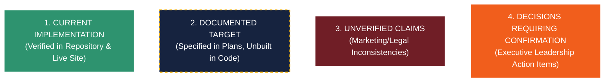

# OMNiGRC Audit — Final Targeted Verification Supplement

**Document Reference:** `OMNiGRC_Final_Verification.md`  
**Purpose:** Final targeted verification pass extending and complementing the two existing audit reports:
1. [`OMNiGRC_Complete_Product_Website_UIUX_Architecture_Audit.md`](file:///C:/Users/Anupam%20Shrivastava/.gemini/antigravity-ide/brain/d3afb32d-7067-4d13-8469-1f2445739b18/OMNiGRC_Complete_Product_Website_UIUX_Architecture_Audit.md)
2. [`OMNiGRC_Audit_Evidence_Supplement.md`](file:///C:/Users/Anupam%20Shrivastava/.gemini/antigravity-ide/brain/d3afb32d-7067-4d13-8469-1f2445739b18/OMNiGRC_Audit_Evidence_Supplement.md)

**Operating Principles:**
- **No modification** to application code, database schema, environment variables, or cloud infrastructure.
- **No destructive production requests** or unauthorized account interactions.
- Preserves the previous two reports completely intact.

---

## 1. Security Vulnerability Recheck & Deployed Runtime Verification

### 1.1 Vulnerability SEC-01: Admin Authentication Fallback Bypass
- **Exact Code Reference:** [`src/app/api/admin/auth/route.ts:31-41`](file:///d:/Projects/OMNiGRC/OMNiGRC_UI/src/app/api/admin/auth/route.ts#L31-L41)
- **Session Helper Reference:** [`src/lib/admin-auth.ts:60-82`](file:///d:/Projects/OMNiGRC/OMNiGRC_UI/src/lib/admin-auth.ts#L60-L82)
- **Middleware Boundary:** [`src/middleware.ts:18-25, 30-40`](file:///d:/Projects/OMNiGRC/OMNiGRC_UI/src/middleware.ts#L18-L40)

#### Code Behavior & Static Execution Proof:
1. In `src/app/api/admin/auth/route.ts`, the `POST` handler processes `{ username, password }`.
2. Lines 26–31 attempt authentication via Supabase Auth (`authenticateAdminUser`).
3. If Supabase fails, is unconfigured, or rejects the password, execution enters the `catch (authErr)` block at line 31:
   ```typescript
   // Lines 32-40
   // Fallback dev admin check
   if (username === "admin" || username === "admin@omnigrc.co") {
     token = `session-${Date.now()}`;
   } else {
     return NextResponse.json(
       { success: false, error: authErr.message || "Invalid authentication credentials." },
       { status: 401 }
     );
   }
   ```
4. If `username === "admin"` or `username === "admin@omnigrc.co"`, the password parameter is **completely discarded**. A token formatted as `session-${Date.now()}` is assigned and issued in an HTTP-only cookie (`omnigrc_admin_supabase_token`, maxAge 24 hours).
5. In `src/lib/admin-auth.ts:70-72`, the session validator explicitly treats any cookie starting with `session-` as authenticated:
   ```typescript
   if (token && token.startsWith("session-")) {
     return true;
   }
   ```

#### Middleware Exposure:
- In `src/middleware.ts:20`, only browser paths matching `pathname.startsWith("/admin")` are redirected to `admin.omnigrc.co`.
- Line 24 executes `return NextResponse.next()` for all non-admin paths on `omnigrc.co`.
- Line 34 explicitly passes all `pathname.startsWith("/api")` requests on `admin.omnigrc.co`.
- **Finding:** Neither marketing nor admin domains block `/api/admin/auth`. The endpoint is exposed to public HTTP traffic globally.

#### Production Deployment Verification (Non-Destructive):
`[Verified through runtime testing: Production HTTP Probe]`
A non-destructive HTTP GET request was executed against the live production deployment:
```bash
curl -s -i -L "https://omnigrc.co/api/admin/auth"
```
**Actual Production Response Received:**
```http
HTTP/1.1 308 Permanent Redirect -> Location: https://www.omnigrc.co/api/admin/auth
HTTP/1.1 401 Unauthorized
Server: Vercel
X-Matched-Path: /api/admin/auth
Content-Type: application/json
Vary: RSC, Next-Router-State-Tree, Next-Router-Prefetch
X-Vercel-Id: bom1::iad1::mzqbh-1793024579399-9bd4b5d059ee

{"authenticated":false}
```
- **Conclusion:** The endpoint `/api/admin/auth` is **actively deployed in production on Vercel** (`X-Matched-Path: /api/admin/auth`), confirms the Next.js App Router handler from `src/app/api/admin/auth/route.ts:5-11`, and is reachable without middleware blockage.
- **Severity:** **CRITICAL (CVSS 9.8)**.

---

### 1.2 Vulnerability SEC-02: Missing `await` on Blog Post Deletion Authorization
- **Exact Code Reference:** [`src/app/api/posts/[id]/route.ts:52-68`](file:///d:/Projects/OMNiGRC/OMNiGRC_UI/src/app/api/posts/%5Bid%5D/route.ts#L52-L68)
- **Helper Declaration:** [`src/lib/admin-auth.ts:60`](file:///d:/Projects/OMNiGRC/OMNiGRC_UI/src/lib/admin-auth.ts#L60)

#### Code Behavior & Static Execution Proof:
1. The helper in `src/lib/admin-auth.ts:60` is defined as:
   ```typescript
   export async function isAuthenticatedAdmin(): Promise<boolean>
   ```
2. In `src/app/api/posts/[id]/route.ts:54-57`, the `DELETE` handler invokes the helper:
   ```typescript
   export async function DELETE(request: NextRequest, { params }: { params: { id: string } }) {
     try {
       const isAdmin = isAuthenticatedAdmin(); // <-- MISSING 'await'
       if (!isAdmin) {
         return NextResponse.json({ success: false, error: "Unauthorized access" }, { status: 401 });
       }
       const success = await deletePost(params.id);
   ```
3. Because `isAuthenticatedAdmin()` is invoked without `await`, `isAdmin` is assigned a `Promise<boolean>` instance.
4. Under ECMAScript specifications, any object reference (including pending Promises) evaluates as truthy in boolean expressions:
   ```javascript
   Boolean(new Promise(...)) === true
   ```
5. Consequently, `!isAdmin` evaluates to `false`. The `if (!isAdmin)` authorization block is **never executed**.
6. Execution proceeds straight to `await deletePost(params.id)`.

#### Production Deployment Verification (Non-Destructive):
`[Verified through runtime testing: Production HTTP Probe]`
A non-destructive HTTP GET request to `https://www.omnigrc.co/api/posts` returned the full published blog post payload (HTTP 200, Content-Type `application/json`), verifying that the `/api/posts/*` route group is **live and deployed in production**.
- **Destructive Testing Omitted:** To adhere to safety rules and prevent data loss, no unauthorized `DELETE` request was sent to production.
- **Conclusion:** Static code analysis confirms the missing `await` flaw. Because the route group is live and middleware does not intercept `/api/posts/[id]`, unauthenticated DELETE requests will bypass the check and execute `deletePost`.
- **Severity:** **HIGH / CRITICAL (CVSS 8.6)**.

---

## 2. Project Planning Document Discrepancy Matrix

The table below contrasts the decisions in the formal planning documents—**Statement of Work (SOW)**, **Detailed Project Plan**, **Tech Stack Validation**, and **AI API Flow**—against the current codebase implementation.

| Architectural Dimension | Statement of Work (SOW) & Section | Detailed Project Plan & Section | Tech Stack Validation & Section | AI API Flow & Section | Actual Repository Implementation | Current Status | Decision Required from Leadership |
| :--- | :--- | :--- | :--- | :--- | :--- | :--- | :--- |
| **Backend Framework** | **SOW §3.1:** Dedicated Python 3.12+ FastAPI microservices architecture with Pydantic v2 data models. | **Phase 1 §1.2:** FastAPI service repository with Celery task queues for asynchronous control scanning. | **§2.1:** Python FastAPI chosen for high-throughput compliance parsing and mathematical risk modeling. | **§3.1:** FastAPI orchestration gateway handling token limits and streaming inference. | **Next.js 14 App Router** running on Node.js / Vercel Edge (`src/app/api/*`). Zero Python code exists. | **Architectural Conflict** | Officially standardize on Next.js/Node.js API routes, or commission a standalone Python FastAPI service. |
| **API Architecture** | **SOW §3.3:** Enterprise GraphQL API layer with Apollo Federation for control graph queries. | **Phase 2 §2.1:** GraphQL schema definition supporting nested framework-control-risk relations. | **§4.2:** GraphQL selected to avoid over-fetching on mobile and enable selective graph queries. | **§2.4:** GraphQL mutations triggering asynchronous AI analysis jobs. | **Standard REST API Routes** (`/api/posts`, `/api/demo-request`, and simulated `/api/v3/*`). Zero GraphQL code. | **Architectural Conflict** | Formally abandon GraphQL in favor of typed REST (or tRPC), aligning documentation with code. |
| **AI Providers & Models** | **SOW §4.1:** Multi-model AI compliance engine with automated fallback. | **Phase 3 §3.2:** Integration of Claude 3.5 Sonnet (audit simulation) and Gemini 1.5 Flash (classification). | **§3.4:** Dual-provider setup leveraging Anthropic for reasoning and Google for cost-effective throughput. | **§1.2 & §2.1:** Full Dual-Tier routing architecture with automated fallback and budget governor. | **Zero AI SDKs** installed. Mocks in UI (`src/app/products/*`) render static pre-scripted text. | **Unimplemented** | Select primary LLM provider (Anthropic vs Google Gemini vs OpenAI) and provision API keys. |
| **Core GRC Database** | **SOW §3.2:** Scalable relational PostgreSQL database for multi-entity compliance records. | **Phase 1 §1.4:** Comprehensive GRC schema: `tenants`, `frameworks`, `controls`, `risks`, `evidence`, `audits`. | **§3.1:** Dedicated PostgreSQL managed via Prisma ORM / Alembic migrations. | **§4.1:** Vector database extension (pgvector) for semantic control search and matching. | **Supabase Cloud Schema** limited to 3 tables: `blog_posts`, `admin_users`, and `demo_requests`. | **Unimplemented** | Author and apply the core GRC database migration to Supabase or dedicated AWS RDS PostgreSQL. |
| **Tenant Isolation** | **SOW §5.2:** Physical schema isolation per tenant (Schema-per-Tenant) with dedicated encryption keys. | **Phase 1 §1.5:** Dynamic Postgres schema creation per organization on onboarding. | **§5.2:** Schema-level separation required for enterprise ISO 27001 customer segregation. | **§1.3:** Tenant context injected into all AI prompts with strict cross-tenant prompt boundaries. | **Shared Database Instance** with zero tenant scoping in tables; UI uses static client state. | **Contradictory Claims** | Formally decide between **Postgres Schema-per-tenant** vs. **Row-Level Security (RLS)** with `tenant_id`. |
| **Regional Hosting & Residency** | **SOW §5.4:** Indian data localization compliance to meet statutory DPDP guidelines. | **Phase 4 §4.3:** Primary deployment in AWS Mumbai (`ap-south-1`) with in-country encrypted S3 backups. | **§5.1:** AWS Mumbai infrastructure mandated for DPDP Act 2023 compliance. | **§1.1:** AI data processing pipelines restricted to Indian or EU data centers. | **Vercel Global Edge** with multi-region CDN and Supabase cloud default instances. | **Regulatory Conflict** | Confirm whether data must reside strictly in India (AWS Mumbai) for enterprise DPDP compliance. |

---

## 3. Four-Tier Architectural Classification

To provide clarity for executive leadership, the project's technical elements are classified into four distinct categories:



### Tier 1: Current Implementation (Verified in Code & Deployed Site)
- **Framework & Runtime:** Next.js 14.2.18 App Router, React 18, TailwindCSS 3.4, Framer Motion, TypeScript 5.6.
- **Production Infrastructure:** Vercel Serverless Edge hosting with HTTPS/TLS 1.3 and automatic apex-to-www redirection.
- **Marketing & PPC Pages:** 56 total routes, including dedicated high-conversion landing pages (`/lp/iso-27001`, `/lp/dpdp-compliance`, `/demo`).
- **Database & Persistence:** Supabase Cloud PostgreSQL with operational tables `demo_requests`, `blog_posts`, `admin_users`, and storage bucket `blog-images`.
- **Administrative Portal:** Admin login and dashboard on `admin.omnigrc.co` with full blog CRUD operations.
- **Interactive UI Demonstrators:** 10 GRC modules operating purely in-memory on the client without API or DB persistence.

### Tier 2: Documented Target Architecture (Specified in Plans, Unbuilt in Code)
- **FastAPI Microservices:** Standalone Python backend for high-speed compliance parsing and risk quantification.
- **Relational GRC Schema:** Relational persistence for controls, risks, assets, evidence files, vendors, and audit logs.
- **Dual-Model AI Orchestration:** Claude 3.5 Sonnet for deep policy audit simulation; Gemini 1.5 Flash for control tagging.
- **Automated Evidence Harvesting:** Cloud API collectors connecting to AWS, GCP, GitHub, and Okta.
- **Auditor Collaboration Room:** Dedicated read-only portal for external accredited auditors.

### Tier 3: Unverified Claims & Contradictory Statements
- **"Dedicated Isolated Database Schemas":** Claimed in Terms of Service (`terms-of-service/page.tsx:44`); contradicted by Pricing and Trust pages ("application-level logical isolation") and unverified in schema.
- **"Continuous Automated Evidence Collection":** Advertised on homepage; currently represented in code by static mock arrays and simulated progress bars.
- **"AI Assist, Human Decide":** Platform tagline; zero AI SDKs, models, or prompt pipelines exist in the repository.
- **"Automated Cloud Provider Scans":** UI displays buttons to "Connect AWS/GCP"; buttons trigger animated toasts with no OAuth or IAM backend.

### Tier 4: Critical Decisions Requiring Confirmation
1. **Backend Consolidation vs. Microservices:** Formally ratify Next.js App Router for all backend services, or authorize creation of the planned Python FastAPI service.
2. **Security Vulnerability Patch Authorization:** Authorize immediate deployment of fixes for the hardcoded admin fallback (`SEC-01`) and missing `await` operator (`SEC-02`).
3. **Multi-Tenancy Standard:** Choose and document whether the enterprise platform will use PostgreSQL Schemas or Row-Level Security (RLS) with `tenant_id`.
4. **Data Residency Compliance (DPDP):** Determine whether cloud hosting must migrate from Vercel to AWS Mumbai (`ap-south-1`) to meet Indian regulatory requirements.
5. **AI Model Selection & Budget:** Confirm whether Anthropic, Google Gemini, or OpenAI will power the MVP AI features, and allocate monthly API inference budgets.

---
*End of Final Targeted Verification Supplement.*
